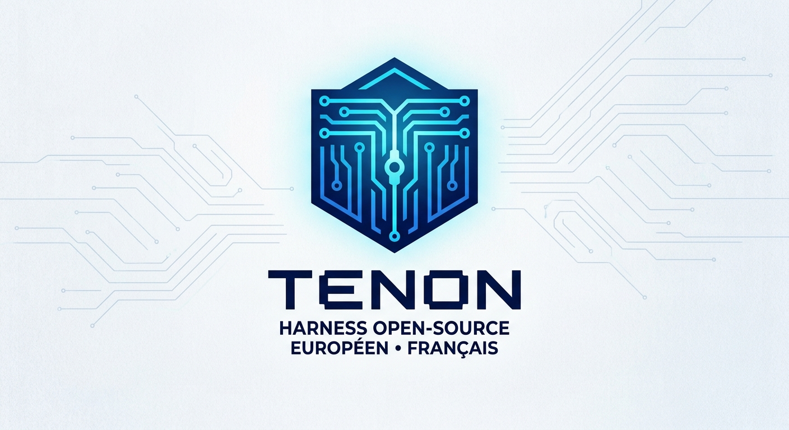
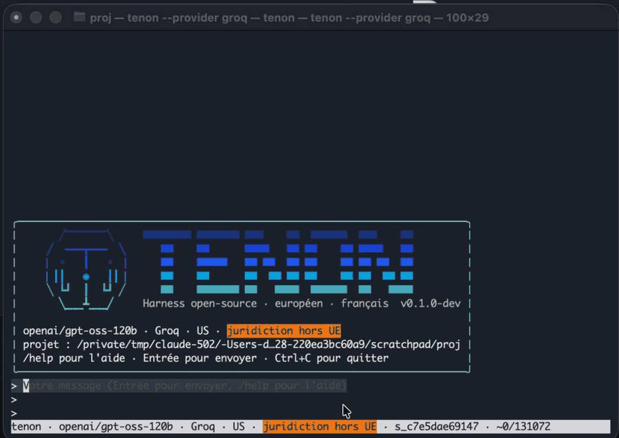

<p align="center"></p>

# tenon

tenon is a terminal coding agent, written in Go.
It reads your project, proposes changes and runs commands, under your control.

It is designed for Europe:

- the preconfigured providers are European (Mistral AI, Codestral, Scaleway, OVHcloud, Albert API of the French State) or local (Ollama, vLLM);
- any data sent outside the EU requires your explicit consent;
- by default, writes, commands and MCP tool calls wait for your approval;
- everything is recorded in a hash-chained, verifiable audit log;
- secrets and some personal data are masked before anything is sent;
- commits that contain code written by the agent can be marked;
- reusable skills in the open Agent Skills format (`SKILL.md`), loaded by the model or with `/<name>`, never able to widen permissions;
- sub-agents (`.claude/agents/*.md` format) that the model launches for a self-contained task, with the same permissions, masking and audit as the main agent;
- hooks (Claude Code format) that run your commands before and after tools, on prompts and at session start and end, to block, ask, add context or change a tool input, without widening permissions; project hooks never run;
- compliance profiles (`eu-only`, `secnumcloud`, `strict-local`): the provider and MCP servers are checked against the profile at startup and before each send, and the profile is recorded in the audit log; `secnumcloud` relies on a declared, never verified, qualification; a `[provider_allowlist]` restricts provider hosts;
- system sandbox: shell commands and stdio MCP servers are confined by the system (Landlock and user namespaces on Linux, `sandbox-exec` on macOS): writes limited to the project, credentials directories unreadable, network closed unless a rule or your answer opens it; `[sandbox] mode = "required"` refuses to run without it ([docs/usage.md](docs/usage.md#system-sandbox), [limits](docs/security.md#the-sandbox-and-its-limits));
- data-sensitivity routing: paths and markers (`DIFFUSION RESTREINTE`, `EU RESTRICTED`, your own) classify a session as sensitive, and from then on it is sent only to a local model, with an ordered fallback to other providers for the rest; the audit log proves each decision and the export flags any violation ([docs/usage.md](docs/usage.md#data-sensitivity-routing), [limits](docs/security.md#data-sensitivity-routing-and-its-limits));
- signed organisation policy (minisign): an administrator imposes a floor (profile, allowed provider hosts, permission and redaction rules, audit level, MCP servers) that users cannot loosen; it is verified at every startup and recorded in the audit log ([docs/policy.md](docs/policy.md));
- RFC 3161 timestamping of the audit log: `[audit.timestamp]` has a timestamp authority sign the head hash, so a log rewritten afterwards is detected by `tenon audit verify` and by the export (no authority is built in, none is called unless you configure one);
- `tenon audit export`: an HTML and JSON compliance report built from the audit log (providers, consents, permissions, modified files, incidents), with no conversation data unless you ask for it;
- checkpoints: each prompt is a restore point, and `/rewind` (or Esc twice) restores the files an agent wrote, the conversation, or both, never overwriting a file you changed without asking.

Any OpenAI-compatible endpoint works.
tenon runs on Linux and macOS.

<p align="center"></p>

## Installation

### Homebrew (macOS, Linux)

```
brew install tenon-code-eu/tap/tenon
```

### Install script (Linux, macOS)

```
curl -fsSL https://raw.githubusercontent.com/tenon-code-eu/tenon/main/install.sh | sh
```

The script installs the latest version in `~/.local/bin` (change the directory with `TENON_INSTALL_DIR`, pin a version with `TENON_VERSION=vX.Y.Z`).
It always verifies the SHA-256 hash of the archive, and the minisign signature if `minisign` is installed (`TENON_REQUIRE_SIGNATURE=1` makes it mandatory).
To install from a mirror (sovereign forge, air-gapped network) instead of GitHub, set `TENON_DOWNLOAD_BASE` and `TENON_VERSION=vX.Y.Z` (the version is required).
The mirror must serve `<base>/<version>/<archive>`, `<base>/<version>/SHA256SUMS` and `<base>/<version>/SHA256SUMS.minisig`; the base must be `https` (`http` is accepted only for `localhost` and `127.0.0.1`).
The hash and signature checks are unchanged.
Read it before you run it: [install.sh](install.sh).

### With Go

```
go install github.com/tenon-code-eu/tenon/cmd/tenon@latest
```

### Binaries

Each version published on the [GitHub Releases](https://github.com/tenon-code-eu/tenon/releases) page provides:

- one `.tar.gz` archive per platform: `linux/amd64`, `linux/arm64`, `darwin/amd64`, `darwin/arm64`;
- `.deb` and `.rpm` packages for Linux (`amd64`, `arm64`);
- a `SHA256SUMS` file, signed with minisign (`SHA256SUMS.minisig`);
- a CycloneDX SBOM.

Verify the signature with the project's minisign public key, provided at the root of the repository (`tenon.pub`):

```
RWR+vfCWjGO42uRKOxNSrKz5afZPCWJf8iJPO04kFdkhLldZHhxo532F
```

Then verify the hashes:

```
minisign -Vm SHA256SUMS -p tenon.pub
sha256sum -c SHA256SUMS --ignore-missing   # macOS: shasum -a 256 -c SHA256SUMS --ignore-missing
```

Then copy the `tenon` binary to a directory in your `PATH`, or install the package:

```
sudo apt install ./tenon_*.deb   # Debian, Ubuntu
sudo dnf install ./tenon_*.rpm   # Fedora, RHEL
```

### From source

You need Go 1.26 or later. Use the latest Go 1.26 patch release (≥ 1.26.10 as of 2026-10-22): earlier ones have known vulnerabilities in the standard library.
The dependencies are included in the repository: no module proxy is contacted.

```
git clone https://github.com/tenon-code-eu/tenon.git
cd tenon
GOFLAGS=-mod=vendor go build -o tenon ./cmd/tenon
```

## Quick start

```
tenon key set mistral                  # stores the key in the system keyring
tenon                                  # interactive interface, in the project directory
tenon -p "explain the project layout"  # one turn without the interface, for scripts
tenon skills                           # lists the skills found for this project
tenon agents                           # lists the sub-agents found for this project
tenon hooks                            # lists the hooks loaded from your own files
tenon rewind --list --resume last      # lists the restore points of a session
```

The key can also come from the `MISTRAL_API_KEY` variable.
Without a key, use a local model: `tenon --provider ollama`.

The interface is in English by default.
For French, run with `--lang fr` or set `lang = "fr"` in the configuration.

To mark the commits that contain code written by the agent:

```
tenon git install-hook
```

## Documentation

- [Usage guide](docs/usage.md): keys, approval, non-interactive mode, sessions, configuration, providers, MCP, git marking, audit, compliance export.
- [tenon in CI](docs/ci.md): templates for GitLab CI, Forgejo/Gitea and GitHub Actions, `--strict`, `--config`, `TENON_DOWNLOAD_BASE` mirror install.
- [Organisation policy](docs/policy.md): signed floor imposed by an administrator.
- [Security and limits](docs/security.md): sovereignty criteria, guarantees, known limits, recovery.
- [Example configuration](docs/config.example.toml): commented file, without secrets.
- [Report a vulnerability](SECURITY.md) and [contribute](CONTRIBUTING.md).
- [Release checklist](RELEASE.md): for maintainers.
- [Specification](docs/superpowers/specs/2026-10-14-tenon-design.md): design choices (in French).

## License

tenon is distributed under the [EUPL-1.2](LICENSE) license.

## En français

tenon est un agent de code en terminal, écrit en Go, pour Linux et macOS.
Il lit votre projet, propose des modifications et exécute des commandes, sous votre contrôle.
Les fournisseurs préconfigurés sont européens (Mistral AI, Codestral, Scaleway, OVHcloud, Albert API de l'État) ou locaux (Ollama, vLLM).
Tout envoi hors de l'UE demande votre accord explicite, et tout est tracé dans un journal d'audit chaîné.
Par défaut, les écritures, les commandes et les appels d'outils MCP attendent votre validation.
Les skills au format ouvert Agent Skills (`SKILL.md`) sont chargés par le modèle ou avec `/<nom>`, sans jamais élargir les permissions.
Les sous-agents (format `.claude/agents/*.md`) sont lancés par le modèle pour une tâche autonome, avec les mêmes permissions, le même masquage et le même audit que l'agent principal.
Les hooks (format Claude Code) exécutent vos commandes avant et après les outils, à l'envoi d'un prompt et au début et à la fin d'une session, pour bloquer, demander, ajouter du contexte ou modifier l'entrée d'un outil, sans élargir les permissions ; les hooks d'un projet ne s'exécutent jamais.
Chaque prompt est un point de restauration : `/rewind` (ou Échap deux fois) restaure les fichiers écrits par l'agent, la conversation, ou les deux, sans jamais écraser sans demander un fichier que vous avez modifié.
Les profils de conformité (`eu-only`, `secnumcloud`, `strict-local`) contrôlent le fournisseur et les serveurs MCP au démarrage et avant chaque envoi, et le profil est enregistré dans le journal d'audit. `secnumcloud` repose sur une qualification déclarée, jamais vérifiée ; une `[provider_allowlist]` restreint les hôtes de fournisseurs.
L'horodatage RFC 3161 du journal d'audit (`[audit.timestamp]`) fait signer le hash de tête par une autorité d'horodatage : un journal réécrit ensuite est détecté par `tenon audit verify` et par l'export. Aucune autorité n'est intégrée, et aucune n'est appelée sans configuration.
L'isolation système confine les commandes shell et les serveurs MCP stdio (Landlock et espaces de noms sous Linux, `sandbox-exec` sous macOS) : écritures limitées au projet, dossiers d'identifiants illisibles, réseau fermé sauf si une règle ou votre réponse l'ouvre ; `[sandbox] mode = "required"` refuse de s'exécuter sans elle ([utilisation](docs/fr/utilisation.md#isolation-système), [limites](docs/fr/securite.md#lisolation-système-et-ses-limites)).
Le routage par sensibilité des données classe une session comme sensible (chemins et marquages comme `DIFFUSION RESTREINTE`, `EU RESTRICTED` ou les vôtres) : elle n'est alors envoyée qu'à un modèle local, avec une bascule ordonnée vers d'autres fournisseurs pour le reste ; le journal d'audit prouve chaque décision et l'export signale toute violation ([utilisation](docs/fr/utilisation.md#routage-par-sensibilité-des-données), [limites](docs/fr/securite.md#le-routage-par-sensibilité-et-ses-limites)).
Une politique d'organisation signée (minisign) permet à un administrateur d'imposer un socle (profil, hôtes de fournisseurs autorisés, règles de permissions et de masquage, niveau d'audit, serveurs MCP) que les utilisateurs ne peuvent pas assouplir ; elle est vérifiée à chaque démarrage et tracée dans le journal d'audit ([politique](docs/fr/politique.md)).
`tenon audit export` produit un rapport de conformité HTML et JSON tiré du journal d'audit (fournisseurs, consentements, permissions, fichiers modifiés, incidents), sans données de conversation sauf si vous les demandez.
L'interface est en anglais par défaut : lancez `tenon --lang fr` ou mettez `lang = "fr"` dans la configuration.

Documentation en français : [guide d'utilisation](docs/fr/utilisation.md), [sécurité et limites](docs/fr/securite.md), [politique d'organisation](docs/fr/politique.md), [tenon en CI](docs/fr/ci.md).
